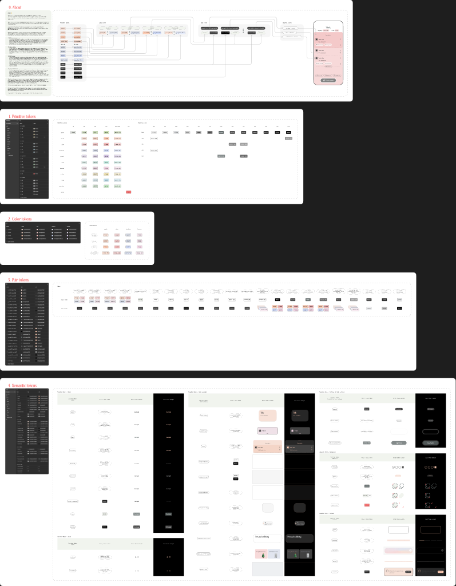
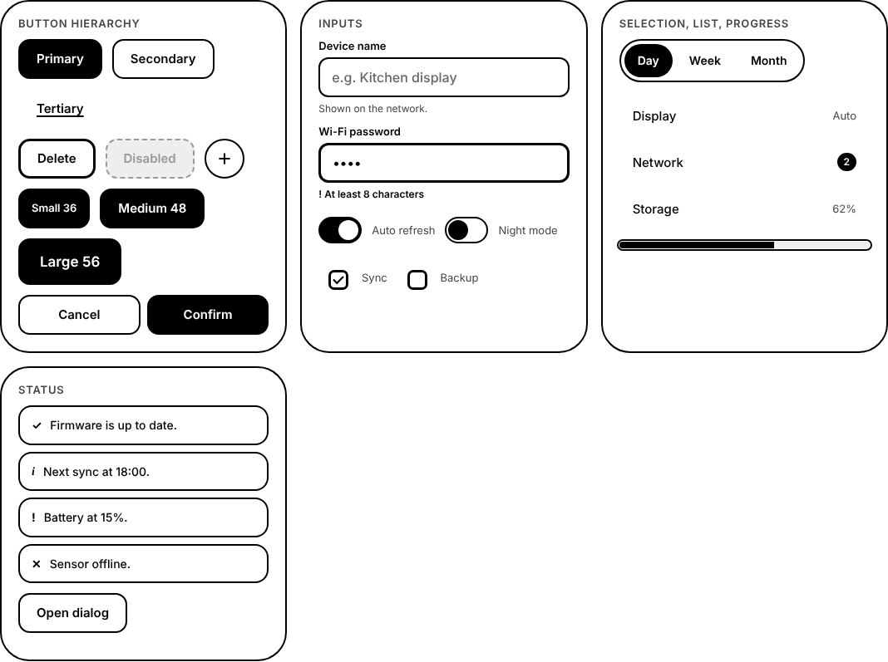
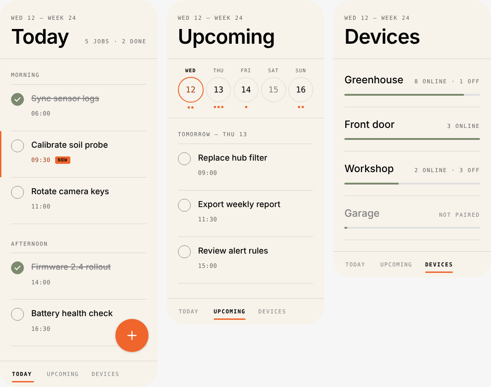

# paper-designsystem

Design tokens for **Papper**, exported from the Figma page
[Colors: tokens system](https://www.figma.com/design/gVnF1G3vYFO74d7UeyaIp7/Papper--Design-library--Community-?node-id=1563-2374)
of *Papper (Design library) (Community)*.



## What's in it

| Figma | Count | Output |
|---|---|---|
| **Primitives** collection: raw palette | 63 variables | `--paper-color-*` |
| **Colors** collection: accent palette, modes `peach` · `pink` · `grayblue` · `lavanda` | 4 variables | `--paper-primary`, `--paper-accent`, `--paper-vibrant`, `--paper-translucent` |
| **Tokens** collection: semantic + pair tokens, modes `light` · `dark` | 77 variables | `--paper-fonts-*`, `--paper-surfaces-*`, `--paper-borders-*`, `--paper-icon-*`, `--paper-components-*`, `--paper-pairs-tokens-*` |
| Text styles | 17 | `.paper-text-*` classes |
| Effect style `slight-shadow` | 1 | `--paper-shadow-slight-shadow` |
| Gradient styles `gradient/light`, `gradient/dark` | 2 | `--paper-gradient-light`, `--paper-gradient-dark` |

On top of the Figma export, `tokens/extensions.json` adds local tokens. It is merged at build time, so re-exporting from Figma never overwrites it:

| Extension | Output |
|---|---|
| **`eink` theme**: a third Tokens mode for e-paper. Uses only opaque grays on the 16-level E Ink grid, with no shadows, translucency or motion | `data-theme="eink"`, applied automatically under `@media (update: slow), (monochrome)` when no theme is set |
| **`graphite` palette**: neutral gray accents that follow light and dark mode | `data-palette="graphite"` |
| **`paper` palette**: warm paper surfaces (`#f7f3eb`), plus `signal/accent` (ember) and `signal/positive` (sage) | `data-palette="paper"`, `--paper-signal-*` |
| `color/ink/0…15` primitives (paper white to full ink) and `color/graphite/*` | `--paper-color-ink-*`, `--paper-color-graphite-*` |
| 95 component and semantic tokens: button/CTA, input, switch, segmented control, list, badge, status, progress, dialog, tab bar, task row, date strip, add button, motion | `--paper-components-*`, `--paper-signal-*`, `--paper-motion-*` |
| 4 extra text styles: `Sans serif/Display`, `Sans serif/List title`, `Mono/Overline`, `Mono/Meta` | `.paper-text-*` |
| Font roles and a bundleable `device` typeface set (Inter, Literata, IBM Plex Mono, all OFL) | `--paper-font-sans/serif/display/mono`, `data-typeface="device"` |

`dist/components.css` turns those tokens into ready-made classes (`.paper-btn`, `.paper-input`, `.paper-switch` and more). See [docs/components.md](docs/components.md). For the typeface research behind the `device` set, see [docs/research/paper-device-fonts.md](docs/research/paper-device-fonts.md).





The system has **independent axes**: theme (`light`/`dark`/`eink`), accent
palette, and typeface (`default`/`device`). Semantic tokens alias the palette, which aliases primitives, so
`fonts/main` is neutral 700 in light mode and the palette's *vibrant* colour in
dark mode.

## Usage

### CSS

```html
<link rel="stylesheet" href="dist/tokens.css">
<link rel="stylesheet" href="dist/components.css">  <!-- optional -->
<html data-theme="eink" data-palette="graphite" data-typeface="device">
```

```css
.card { background: var(--paper-surfaces-main-first-layer); color: var(--paper-fonts-main); }
```

- Defaults are `light` + `peach` when no attributes are set.
- The generated CSS keeps the Figma alias chain as `var()` references, so
  switching either attribute re-themes everything.
- `data-palette` alone on a subtree swaps the palette and keeps the page theme.
  `data-theme` on a subtree forces that theme.
- Set `color` (and other inherited properties) on the themed element itself,
  not only on `body`. Inherited colours are resolved where they are declared.
- One known limit: a palette-only element inside a `light` subtree that is
  itself inside a `dark` page resolves as dark. Put `data-theme` on that
  element as well.

### JavaScript / TypeScript

```js
import { resolveTokens, tokens, typography, gradients } from '@benhardaway77/paper-designsystem';

resolveTokens('dark', 'lavanda')['fonts/main']; // '#f5d6e6'
tokens.light.peach['components/card/main-card-radius']; // 35
```

`dist/tokens.json` contains the same data (all 18 theme × palette combinations,
fully resolved).

### Fonts

Text styles map each Figma family to a role (`sans`, `serif`, `display`, `mono`)
and use `var(--paper-font-<role>)`, so one attribute swaps every typeface.

| Role | `default` (Figma) | `device` (`data-typeface="device"`) |
|---|---|---|
| sans | SF Pro | Inter |
| serif | New York | Literata |
| display | Hacky | Literata |
| mono | IBM Plex Mono | IBM Plex Mono |

No fonts are bundled. **SF Pro and New York are licensed only for Apple
platforms and Hacky is commercial**, so on Linux or Android edge devices use the
`device` set and ship its OFL font files with your firmware. Font weights are
derived from the Figma style names (SF Pro Semibold = 590).

## Layout

```
figma/variables.json          raw Figma export (modes + aliases), never hand-edited
tokens/extensions.json        local layer: eink theme, graphite palette, component tokens, fonts
components/components.css     component classes (copied to dist/components.css)
scripts/lib.mjs               transforms (pure, unit-tested)
scripts/build.mjs             writes dist/
scripts/figma-export.plugin.js  re-export script (Figma Plugin API)
dist/                         generated, committed for direct use
docs/index.html               live demo: theme/palette/typeface switcher + component gallery
docs/components.md            component and CTA guidelines
docs/research/                paper-device typeface research
test/                         node:test suite
```

## Updating from Figma

Figma's Variables REST API is Enterprise-only, so the export runs as Plugin API
code instead:

1. Run `scripts/figma-export.plugin.js` against file `gVnF1G3vYFO74d7UeyaIp7`,
   either through the Figma MCP `use_figma` tool or as a scratch plugin.
2. Save the returned JSON over `figma/variables.json`.
3. `npm run build && npm test`, then commit. `tokens/extensions.json` is
   layered on at build time. If Figma renames a variable that an extension
   references, the build fails with the name.

## Development

```bash
npm test          # unit tests (no dependencies)
npm run build     # regenerate dist/
python3 -m http.server 4177   # then open http://localhost:4177/docs/
```

## Related

[`benhardaway77/design-system`](https://github.com/benhardaway77/design-system)
syncs the 4 published *styles* from the same Figma file daily. This repo covers
the full *variables* system that the styles sync does not see.

## Credits

The token values, names and type choices come from the Figma Community file
*Papper (Design library)*. They remain subject to that file's Community license
and belong to its original author. This repo adds only the export and build
tooling.
